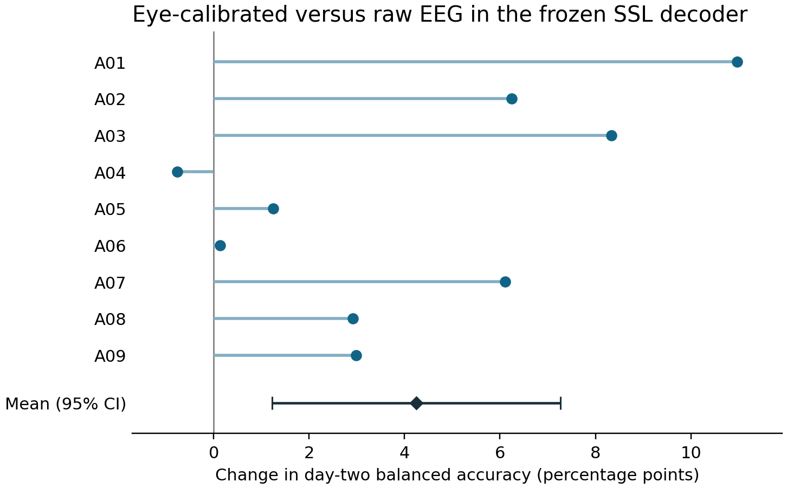

# Cross-Day EEG Calibration for Motor Imagery

**Mona** · [GitHub profile](https://github.com/Monazarei95)

Can an eye-movement recording collected on the first day help a computer decode imagined movement on another day? This project evaluates that question using a frozen self-supervised EEG encoder, a classical covariance decoder, and matched calibration controls.

[Interactive dashboard](https://monazarei95.github.io/cross-day-eeg-calibration/) · [Paper draft](cross_day_paper.md) · [Hand-only analysis](hands_results.md) · [Experiment log](EXPERIMENT_LOG.md) · [Published results](results/)

## Main finding

On BCI Competition IV 2a, first-day eye calibration increased next-day balanced accuracy for the frozen encoder from **37.04% to 41.29%**. The paired gain was **4.24 percentage points**, with a **95% confidence interval of 1.22 to 7.27**. Eight of nine participants improved using ten labeled training trials per class.

| Decoder | Uncorrected EEG | Random projection | Scalp-only calibration PCA | Eye-calibrated projection |
|---|---:|---:|---:|---:|
| Frozen self-supervised encoder | 37.04% | 37.25% | 40.08% | 41.29% |
| Classical covariance decoder | 43.80% | 44.14% | 47.26% | 46.74% |

Each score averages five matched label draws within each participant and then weights participants equally. Random scores also average 16 equal-rank projections. Balanced accuracy weights the four movement classes equally. [Scored evaluation](results/cross_day_v1_scores/)



The result supports transferring a first-day calibration transform to a later recording. The extra benefit of dedicated eye electrodes over scalp-only calibration remains uncertain, with a gain of 1.21 points and a 95% interval of −0.24 to +2.66. The classical decoder with scalp-only calibration achieved the highest average accuracy.

## Left/right-hand analysis

A later exploratory analysis fitted new binary classifiers using only left- and right-hand trials. The same second-day session supplied 144 hand trials per participant. Because the four-class labels had already been inspected, this is not a new blinded confirmation.

| First-day labels per hand class | Frozen encoder, best condition | Classical decoder, best condition |
|---|---:|---:|
| 10 | 61.39% eye projection | 64.88% scalp PCA |
| 72 | 67.28% scalp PCA | **69.37% scalp PCA** |

The eye projection removed three of 22 spatial directions and retained 11.26% of measured 8–30 Hz signal energy on the second-day task windows. That energy includes artifacts, so its neural fraction is unknown. C3/C4 left-right power-contrast direction was unchanged for seven of nine people in each of the mu and beta bands. The current results do not establish that useful brain signal is fully preserved, or reach an 80% average. [Methods, all scores, and caveats](hands_results.md)

## Study design

1. Pretrain a compact contrastive encoder on first-day recordings from eight participants.
2. Estimate a spatial correction from the held-out person's separate first-day eye-movement block.
3. Fit a classifier with ten labeled first-day imagery trials per class and freeze the decoder.
4. Predict all 288 second-day trials using scalp EEG alone.
5. Repeat for all nine people, freeze the prediction inventory, and score against official labels.

The signal window is 1.75–3.75 seconds after cue onset in the 8–30 Hz band. Controls share label draws and evaluation trials. The primary comparison and practical success criterion were fixed before scoring. [Protocol](configs/cross_day.toml)

## Experiment status

| Experiment | Status | Finding |
|---|---|---|
| Corrected within-day calibration pilot | Complete and replayed | Classical calibration gain of 3.70 points |
| Eye-matched contrastive training screen | Complete and replayed | Fell short of its advancement criterion |
| Equal-rank random-projection control | Complete | Calibration beat both controls in all nine classical-decoder participants |
| Locked next-day BCI IV 2a evaluation | Complete and independently checked | Primary gain of 4.24 points |
| Independent OpenBMI extension | Complete and independently checked | +0.89 points versus raw EEG |
| Exploratory left/right extension | Complete and independently checked | Best nine-person mean 69.37%; preservation unresolved |

Independent OpenBMI evaluation completed for all 54 participants. The frozen encoder reached 54.20% on raw EEG and 55.08% after scalp-only calibration. The paired gain was +0.89 points (95% CI -0.33 to +2.10), with 28 people improving. Official labels were recovered from files matching the frozen source hashes. An independent pass verified participant accuracies and both paired intervals. [Full evaluation](openbmi_results.md)

## Installation

The reference environment uses **Python 3.11**, Git, and CPU execution. The OpenBMI downloader uses `curl.exe` on Windows. Run these PowerShell commands from your chosen project location.

```powershell
git clone https://github.com/Monazarei95/cross-day-eeg-calibration.git
cd cross-day-eeg-calibration
py -3.11 -m venv .venv
.\.venv\Scripts\python.exe -m pip install -c constraints-pilot.txt -e ".[dev,ssl]"
.\.venv\Scripts\python.exe -m pytest -q
```

Versions are pinned in [pyproject.toml](pyproject.toml) and [constraints-pilot.txt](constraints-pilot.txt). Eighteen automated tests cover the protocol, calibration, sampling, logging, reporting, and read-error handling. Floating-point results can vary across platforms and numerical libraries.

## Data preparation

### BCI Competition IV 2a

Obtain the original GDF recordings and official evaluation labels from the competition website. The dataset contains nine participants, two recording days, 22 EEG channels, three eye-signal channels, and four imagined movements. The loader handles missing-sample separators in the calibration block. [Official download](https://www.bbci.de/competition/iv/download/) · [Dataset guide](https://www.bbci.de/competition/iv/desc_2a.pdf)

```text
BCICIV_2a/
  A01T.gdf ... A09T.gdf
  A01E.gdf ... A09E.gdf
  labels/
    A01E.mat ... A09E.mat
```

### OpenBMI

The extension uses 54 participants, two recording days, 62 scalp channels, and left/right hand imagery. First-day eye-task EEG supplies three-component PCA calibration. The selected 162 original files require approximately **66.23 GB**, plus prepared arrays and outputs. Choose a reliable volume with sufficient free space. [Original release](https://gigadb.org/dataset/100542)

```powershell
.\.venv\Scripts\python.exe scripts/run_openbmi.py --storage F:/OpenBMI
```

Replace the storage path with your chosen location. The driver downloads and verifies files, prepares arrays, trains six folds, freezes predictions, scores them, generates a figure, and independently checks the scores. Successful verification updates the local paper and dashboard. Transfer interruptions reuse partial files. Preserve failed run directories when diagnosing errors.

## Reproduce the main evaluation

Generate predictions from the original recordings using the fixed configuration, then score them using the official second-day labels.

```powershell
.\.venv\Scripts\python.exe -m ocular_mi.cross_day --config configs/cross_day.toml --data BCICIV_2a --output runs/cross_day_v1
.\.venv\Scripts\python.exe -m ocular_mi.score_cross_day --predictions runs/cross_day_v1 --labels BCICIV_2a/labels --output runs/cross_day_v1_scores
```

Regenerate the figures and dashboard data.

```powershell
.\.venv\Scripts\python.exe scripts/plot_cross_day.py runs/cross_day_v1_scores cross_day_gain.png --controls cross_day_controls.png
.\.venv\Scripts\python.exe scripts/export_dashboard.py runs/cross_day_v1_scores
```

Reproduce the exploratory hand-only analysis from the saved encoders and first-day projections:

```powershell
.\.venv\Scripts\python.exe -m ocular_mi.hands predict --data BCICIV_2a --previous results/cross_day_v1 --output runs/hands_v1
.\.venv\Scripts\python.exe -m ocular_mi.hands score --predictions runs/hands_v1 --labels BCICIV_2a/labels --output runs/hands_v1_scores
.\.venv\Scripts\python.exe scripts/verify_hands.py --predictions runs/hands_v1 --labels BCICIV_2a/labels --scores runs/hands_v1_scores
```

For a quick inspection with bundled scores, substitute `results/cross_day_v1_scores` in the plotting and dashboard commands. The [published prediction files](results/cross_day_v1/) support rescoring against independently obtained official labels. Use a fresh output directory for each run.

## Reproduce development experiments

```powershell
.\.venv\Scripts\python.exe -m ocular_mi.cli --config configs/bci2a_pilot.toml --data-root BCICIV_2a --output runs/bci2a_cpu_v2
.\.venv\Scripts\python.exe -m ocular_mi.ssl_screen --config configs/ssl_screen.toml --data BCICIV_2a --output runs/ssl_screen_v1
.\.venv\Scripts\python.exe -m ocular_mi.projection_control --config configs/projection_control.toml --data BCICIV_2a --encoder-run runs/ssl_screen_v1 --output runs/projection_control_v1
```

The projection configuration pins the expected encoder checkpoint hash. Fresh processes reproduced the corrected pilot and contrastive screen byte for byte on the reference environment. Compare two compatible runs with the utility below.

```powershell
.\.venv\Scripts\python.exe scripts/compare_runs.py runs/first runs/second --require-identical
```

## Reproducibility and repository structure

| Location or artifact | Purpose |
|---|---|
| `configs/` | Fixed signal windows, seeds, label budgets, and comparisons |
| `src/ocular_mi/` | Processing, training, scoring, and logging |
| `scripts/` | Download, orchestration, plotting, and reporting |
| `tests/` | Automated protocol and implementation checks |
| `results/` | Published summaries, prediction files, and SHA-256 inventory |
| `docs/` | Interactive GitHub Pages dashboard |
| `cross_day_paper.md` | Paper draft and interpretation |
| `EXPERIMENT_LOG.md` | Experimental decisions, corrections, and execution history |
| `hands_results.md` | Exploratory hand-only scores and signal-preservation checks |

Recorded runs include environment manifests, input digests, executable source snapshots, event logs, and frozen predictions. The [published inventory](results/inventory.json) covers the bundled scientific outputs. Development revision identifiers in the experiment log refer to the original local research records. The public repository begins with one release commit.

## Interactive dashboard

The dashboard explains the experiment in plain language and provides six comparisons, participant charts, score tables, and CSV exports. Open `docs/index.html` locally or visit the published page. [Study dashboard](https://monazarei95.github.io/cross-day-eeg-calibration/)

GitHub Pages serves `docs/` from `main`. For another fork, select **Settings → Pages → Deploy from a branch**, then **main** and **/docs**.

## Interpretation and limitations

The main result concerns a compact frozen encoder, a small label budget, and offline trial scoring. Nine participants, overlapping pretraining cohorts, and one encoder seed per fold limit generalization. Paired t intervals summarize differences across participants. Repeated label draws do not increase the independent sample size.

The classical comparator and scalp-only PCA control constrain claims about the value of self-supervised learning and dedicated eye electrodes. The physiological source of removed directions remains uncertain. OpenBMI evaluates a related binary task with scalp-only calibration. Its findings are reported separately from the four-class BCI IV 2a test. Competition leaderboard scores use a different evaluation protocol.

## Attribution

Maintained by [Mona](https://github.com/Monazarei95). Cite the original datasets and methods when reusing the research materials. Dataset access and reuse follow their providers' terms. The paper draft links related studies and explains the contribution and its scope.
