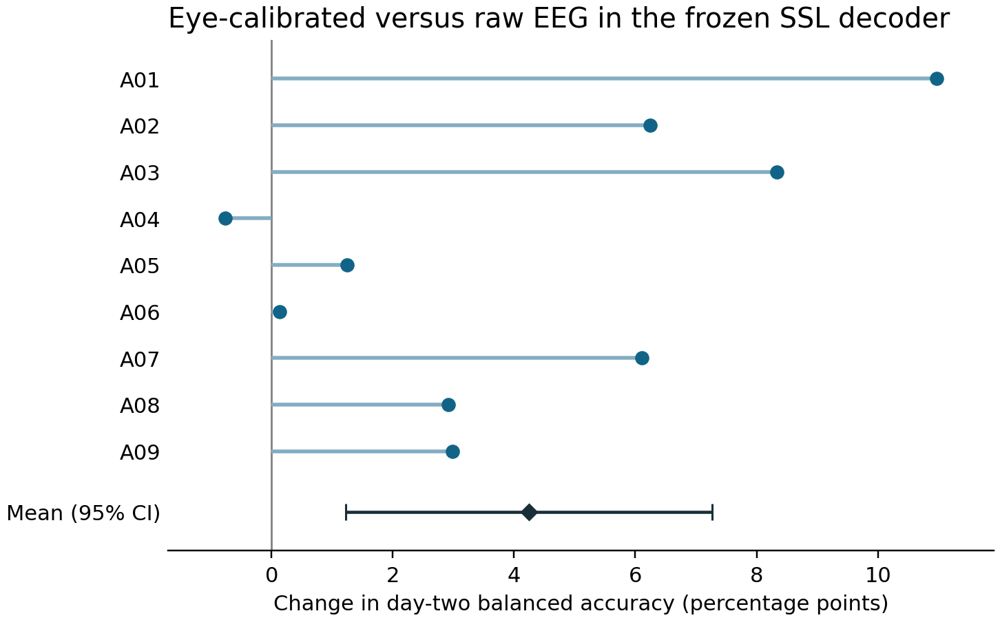
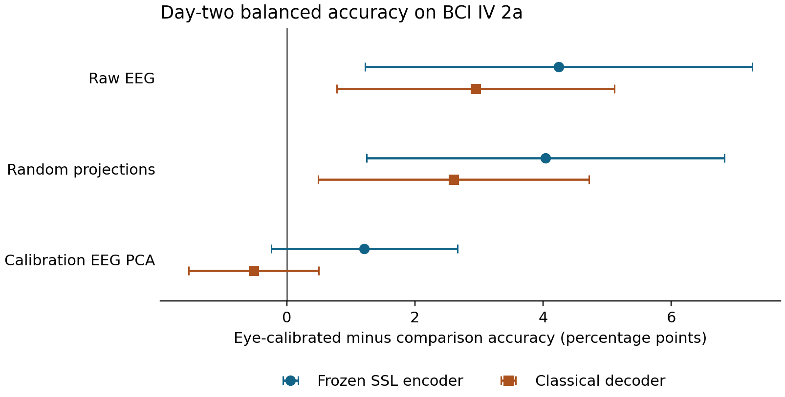

# Day-one eye calibration improves next-day decoding with a frozen self-supervised EEG encoder

## Abstract

Can a motor-imagery decoder use eye-movement calibration on one day and operate from EEG alone on another? We tested this question on all nine participants in BCI Competition IV 2a. For each participant, we pretrained an encoder on the other eight participants, estimated a spatial projection from the target participant's first-day calibration, and trained a classifier with ten labeled imagery trials per class. We froze predictions for all 2,592 second-day trials before opening the evaluation labels. Eye-calibrated projection increased mean four-class balanced accuracy from 37.04% to 41.29%, a paired gain of 4.24 percentage points (95% CI 1.22 to 7.27). Eight of nine participants improved. Equal-rank random projections averaged 37.25%. Removing the largest EEG principal components from the same calibration block reached 40.08%, leaving the incremental benefit of eye electrodes uncertain. A classical covariance decoder with the principal-component control achieved the highest mean accuracy, 47.26%. The results support reusing a first-day calibration transform with a frozen encoder under a small label budget.

Independent OpenBMI evaluation completed for all 54 participants. The frozen encoder reached 54.20% on raw EEG and 55.08% after scalp-only calibration. The paired gain was +0.89 points (95% CI -0.33 to +2.10), with 28 people improving. Official labels were recovered from files matching the frozen source hashes. An independent pass verified participant accuracies and both paired intervals. A subsequent exploratory left/right-only analysis on BCI IV 2a reached 61.39% with the eye-projected frozen encoder and ten first-day labels per class. Its highest mean was 69.37% with a classical decoder and all 72 first-day hand labels per class. The hard eye projection retained 11.26% of measured 8–30 Hz energy, which does not establish preservation of neural information.

## Research question

Recent self-supervised motor-imagery methods learn representations across people, while cue-timing studies show that deep decoders can exploit visually evoked activity. A practical question remains when deploying a decoder on another day: can an inexpensive spatial correction learned during a separate calibration recording improve a fixed EEG representation? We compare eye-informed correction against removing arbitrary directions and against removing high-variance EEG directions measured during the same eye movements. This comparison tests the value of recording eye signals over and above the value of the calibration task itself. [SSL-MEMI, ICASSP 2025](https://ieeexplore.ieee.org/abstract/document/10888531) · [Trocellier et al., 2026](https://www.frontiersin.org/journals/neuroergonomics/articles/10.3389/fnrgo.2026.1804143/full)

An ocular correction study on the same dataset reported higher EEGNet accuracy after denoising. Its denoiser used the participant’s evaluation-session eye calibration during adaptation. Here the practical constraint is that a returning participant supplies only imagery EEG. All spatial filters, including the EEG-only PCA control, are estimated on the first day and are fixed before the second-day recording is evaluated. The two studies therefore address different calibration budgets. [Xie et al., 2026, sections 4.1–4.2](https://www.mdpi.com/2076-3425/16/10/1124)

## Methods

BCI IV 2a contains two sessions per person, recorded on different days, with 22 EEG channels and three electrooculography (EOG) channels. Each session contains 72 trials per imagery class: left hand, right hand, both feet and tongue. We retained all evaluation trials. We used the 8–30 Hz band and the interval 1.75–3.75 seconds after cue onset. A fourth-order forward–backward Butterworth filter used 0.25 seconds of context at either end. This yields one offline prediction per trial. The original competition evaluated continuous, causal outputs on a different scoring protocol. [Official dataset description](https://www.bbci.de/competition/iv/desc_2a.pdf)

In each leave-one-person-out fold, the eight other participants' first-day recordings supplied the unlabeled pretraining trials. A spatial convolution and depthwise temporal convolution produced 32 log-power features. A projection head was used for eight epochs of contrastive training with cropped and masked views and eight uniformly sampled within-session negatives per anchor. We froze the encoder and fit a standardized logistic classifier on five paired draws of ten trials per class from the target person's first day. Each draw trains a separate classifier. The classical comparator used shrinkage covariances, tangent-space features and logistic regression on the identical draws.

During the target person's first-day eye-movement block, we fit a ridge regression from EOG to EEG and projected EEG onto the complement of the fitted map's column space. We applied this fixed projection to both the target probe-training trials and the second-day EEG. Controls used unmodified EEG, 16 isotropic random subspaces of the same removed rank, and the leading EEG principal components (PCA) of the same block at that rank. All four conditions shared the encoder, label draws and evaluation trials. Day-two prediction required EEG alone. [Implementation](src/ocular_mi/cross_day.py)

The primary estimate was the participant-averaged difference in balanced accuracy between eye-calibrated and raw EEG with the frozen encoder. We averaged draws and random projections within each participant and computed a paired two-sided 95% t interval across the nine people. Before scoring, we set a practical target of an observed gain of at least three points with a lower bound above zero. We saved the prediction hashes before scoring. The other comparisons were secondary and their intervals are descriptive. [Protocol and decision history](EXPERIMENT_LOG.md)

## Results

| Decoder | Raw EEG | Random projection | Calibration EEG PCA | Eye-calibrated projection |
|---|---:|---:|---:|---:|
| Frozen self-supervised encoder | 37.04% | 37.25% | 40.08% | 41.29% |
| Classical covariance decoder | 43.80% | 44.14% | 47.26% | 46.74% |

The frozen encoder met the prespecified primary criterion. Individual effects ranged from −0.76 to +10.97 points. Its advantage over the average random projection was 4.04 points (95% CI 1.25 to 6.83). Its advantage over calibration EEG PCA was 1.21 points (95% CI −0.24 to 2.66). The largest single-person gain occurred in A01. [Participant data](results/cross_day_v1_scores/participants.csv)

As a descriptive influence check, we omitted one participant's scored difference at a time and recomputed the mean for the remaining eight. The mean gain ranged from +3.40 points when A01 was omitted to +4.87 points when A04 was omitted. This calculation reused the frozen predictions. It measures how strongly each participant influences the reported mean.

*Figure 1. Each point shows one participant's difference between eye-calibrated and raw EEG after averaging five paired draws. The diamond and interval summarize the nine participant differences.*

For the classical decoder, calibration improved accuracy over raw EEG by 2.95 points (95% CI 0.78 to 5.11). Seven of nine participants improved. The corresponding difference relative to calibration EEG PCA was −0.52 points (95% CI −1.53 to 0.50). [Locked score summary](results/cross_day_v1_scores/summary.json)

*Figure 2. Points show the mean within-person difference over all nine participants. Bars show paired 95% t intervals. Positive values favor the eye-calibrated input. Frozen SSL versus raw EEG was the primary comparison. The other five intervals are descriptive.*

## Exploratory left/right extension

We refitted binary classifiers using only left- and right-hand first-day labels and scored only the 144 corresponding second-day trials per participant. The encoders and projections were unchanged. With ten labels per class and five matched draws, the frozen encoder improved from 57.13% raw to 61.39% eye-projected balanced accuracy, while the classical decoder reached 64.88% with scalp-only PCA. With all 72 first-day trials per hand class, the best mean was 69.37% for classical scalp PCA; the frozen encoder reached 67.28% with scalp PCA. The binary analysis does not reach an 80% mean or reverse the classical advantage. Because the four-class official labels had been seen before this analysis was planned, these results are exploratory. [Full binary report](hands_results.md)

The eye projection removes three spatial directions and retained only 11.26% of measured 8–30 Hz energy on the second-day task windows. This includes artifacts and brain signal. The sign of the C3/C4 left-right power contrast remained the same for seven of nine participants in each of the mu and beta bands, but this limited check cannot establish that neural information was preserved. The present method should not be described as information-preserving.

## Interpretation and limitations

<!-- openbmi-result:start -->
Across 54 people, scalp-only calibration changed next-day balanced accuracy by +0.89 percentage points (95% confidence interval -0.33 to +2.10). 28 people improved. [Independent OpenBMI evaluation](openbmi_results.md)
<!-- openbmi-result:end -->

First-day spatial correction transferred across sessions for both decoders. Removing an arbitrary subspace of the same size produced little average change, so the choice of directions mattered. The PCA control recovered much of the frozen encoder's gain and achieved the highest observed accuracy with the classical decoder. This makes calibration EEG alone a credible alternative when eye electrodes are inconvenient.

The result measures decoding accuracy. It leaves open how much improvement came from suppressing ocular contamination versus suppressing other high-variance activity. An earlier development experiment that used EOG to select contrastive negatives did not meet its advancement criterion. The cross-day result belongs to input projection with a uniform-negative encoder. The nine participants, overlapping pretraining cohorts, one pretraining seed per fold limit the generalization of the dedicated eye-electrode result. The interval's lower endpoint also allows a true mean gain smaller than three points. An independent multisession dataset with a comparable calibration block and enough EEG channels to support the projection would provide a direct replication.
