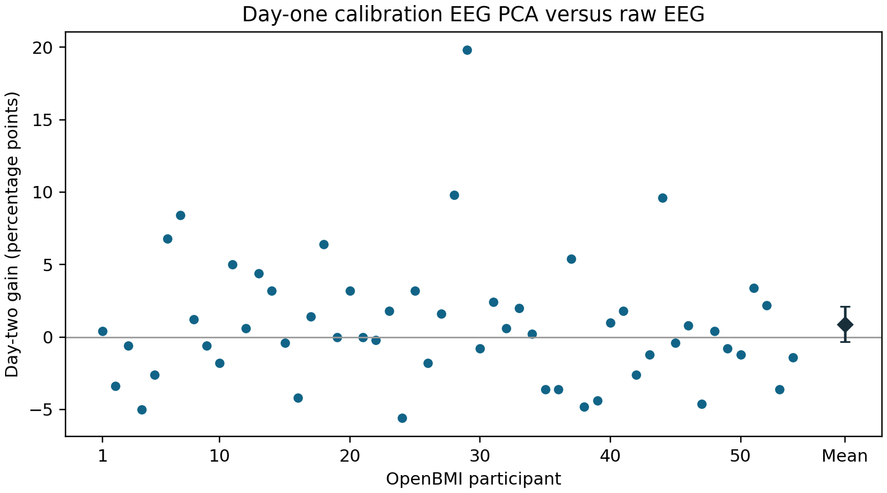

# Independent OpenBMI evaluation

54 people performed left- and right-hand imagery on two days. Each target contributed ten first-day labels per class for each of five paired draws. We fit PCA during 30 seconds of first-day eye tasks and removed three EEG directions. The day-two decoder used EEG alone. Each encoder excluded its evaluation participants.

| Input to the frozen encoder | Day-two balanced accuracy |
|---|---:|
| Raw EEG | 54.20% |
| Day-one calibration EEG PCA | 55.08% |
| Mean of 16 random projections | 54.28% |

The primary calibrated-minus-raw difference was +0.89 percentage points (paired 95% CI -0.33 to +2.10). 28 of 54 people improved. This fell short of the criterion of a gain of at least three points with a positive lower confidence bound.

Against random projections the difference was +0.80 points (95% CI -0.33 to +1.93). OpenBMI tests the EEG-only PCA procedure. The dedicated eye-electrode procedure remains evaluated in BCI IV 2a. Binary OpenBMI and four-class 2a scores are reported separately.

An independent pass recomputed balanced accuracy from frozen predictions and labels and checked participant-level summaries and both paired intervals.
